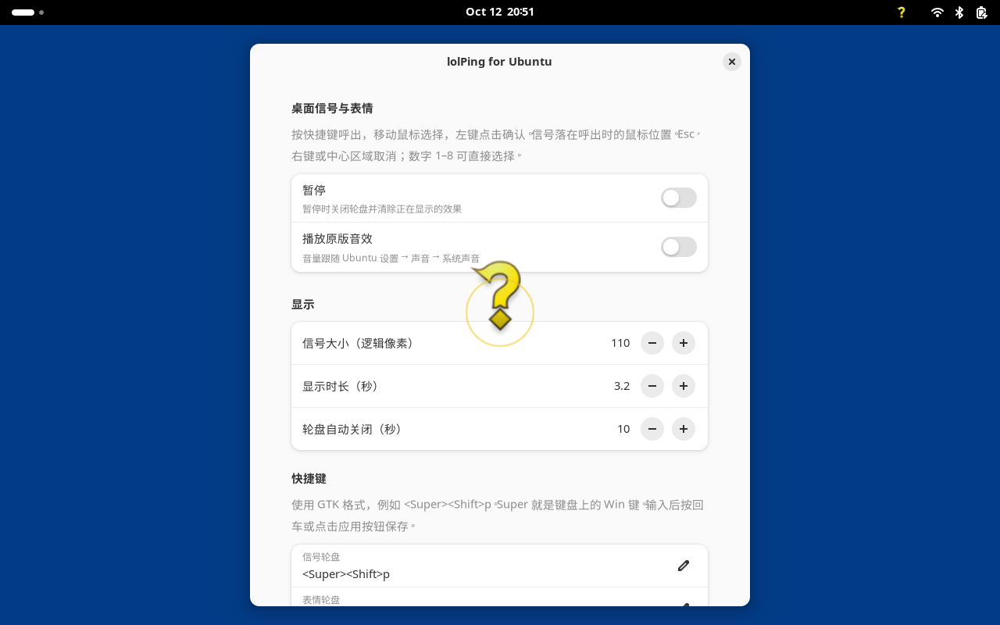

# lolPing Ubuntu 桌面适配版

**原项目：[darrenprx/lolPing](https://github.com/darrenprx/lolPing)，作者：[darrenprx](https://github.com/darrenprx)。**

本仓库只是原项目的 fork，新增了 Ubuntu / GNOME 桌面适配及相关文档。原有 Windows/macOS 实现来自原项目，Ubuntu 适配复用了原项目的图标和音效；本仓库不是原项目的官方发行版。

Ubuntu 适配适用于 **Ubuntu 24.04 / GNOME Shell 46**。
支持 Wayland；同一套 GNOME API 也适用于 X11，但本次主要验证 Wayland。
不需要 Node.js、Electron、C++ 编译器或 root 权限。

## 使用

| 操作 | 默认快捷键 |
| --- | --- |
| 信号轮盘 | Super（Win）+ Shift + P |
| 表情轮盘 | Super（Win）+ Shift + E |
| 暂停 / 恢复 | Super（Win）+ Shift + O |

把鼠标放在想打信号的位置，按快捷键，移动鼠标到目标方向，然后左键点击确认。
也可以按数字 1–8（从上方开始，顺时针）直接确认。信号在**呼出时的位置**显示。
在中心区域确认、右键、Esc 都会取消。轮盘 10 秒后自动关闭（可设置）。
轮盘会在屏幕边缘向内移动，确保选项可见；这不会改变信号落点。
未打开轮盘时不拦截键鼠。信号和表情不接收点击，不影响下面的应用。

顶部面板的问号图标提供信号、表情、暂停、音效和设置入口。
设置可改快捷键、大小、时长、超时。音效使用原版文件，跟随 GNOME 系统声音音量。
暂停会清除显示效果和正在播放的音效。锁屏时不显示，也不能呼出轮盘。
扩展启用后随桌面会话加载；可以从面板菜单关闭。

## 音效排查

若轮盘正常但没有声音，请检查扩展的“音效”开关、系统音量和当前输出设备。
本扩展使用 GNOME 系统音效通道，因此 Ubuntu 的系统音效总开关也必须开启：

```sh
gsettings get org.gnome.desktop.sound event-sounds
# 若为 false，可开启；这也会恢复其他系统提示音
gsettings set org.gnome.desktop.sound event-sounds true
```

蓝牙耳机连接时，音效会跟随当前系统输出设备。设置修改会即时生效，无需重启扩展。

## 安装

先在本仓库根目录构建扩展包（只需要 Python 3 和 `glib-compile-schemas`；Ubuntu 24.04 默认桌面通常已具备）：

```sh
python3 linux/build.py --output release/lolping-ubuntu@local.shell-extension.zip
```

然后安装：

```sh
gnome-extensions install --force release/lolping-ubuntu@local.shell-extension.zip
gnome-extensions enable lolping-ubuntu@local
```

**首次安装可能需要手动注销并重新登录一次**，让 GNOME 发现新扩展；Wayland 不能用 Alt+F2 → r 重启 Shell。
若提示扩展不存在，保存工作、重新登录后再运行 enable 命令。不要自动注销正在使用的桌面。
如果 GNOME 的“禁用用户扩展”开关已开启，需要在“扩展”应用里启用扩展总开关。

```sh
# 状态、设置、停用、卸载
gnome-extensions info lolping-ubuntu@local
gnome-extensions prefs lolping-ubuntu@local
gnome-extensions disable lolping-ubuntu@local
gnome-extensions uninstall lolping-ubuntu@local
```

## 范围

- 8 方向信号轮盘、8 个原版表情、透明桌面效果、原版音效、多显示器、暂停和原生设置。
- 此版用快捷键呼出，不拦截原版的 Alt / Ctrl 拖动手势。
- 表情使用原版 PNG 加弹出/消退动画，不是原项目的完整 WebP 帧动画。
- 此版没有好友房间同步、自定义图片、轮盘布局编辑、自动更新或全屏自动暂停。
- GNOME 之外的桌面环境（例如 KDE）不支持；未声明支持其他 GNOME 主版本。
- 屏幕共享是否包含效果取决于录屏工具与捕获方式，分享单个窗口一般不包含桌面效果。
- 用户修改快捷键时需避开其他应用/系统快捷键；快捷键冲突可在设置中更换。

## 开发与测试

在完整上游仓库根目录执行：

```sh
python3 linux/build.py --output release/lolping-ubuntu@local.shell-extension.zip
node --test linux/tests/geometry.test.mjs
```

构建脚本从上游 catalog 提取资源，只打包需要的图标和音效。源格式变化或资源缺失会报错。
GNOME 集成测试脚本见 `linux/tests/`，使用独立 D-Bus、配置和虚拟显示器，不操作当前桌面。

```sh
python3 linux/build.py --output release/lolping-ubuntu@local.shell-extension.zip --stage release/gnome-stage
python3 linux/tests/integration.py --extension release/gnome-stage --work release/gnome-test
```

`--stage` 和 `--work` 需要使用尚不存在的新目录。

已在 Ubuntu 24.04 / GNOME 46 / Wayland 的独立双屏测试会话中通过 25 项集成检查和 4 项几何测试。
检查包括真实快捷键与鼠标输入、覆盖 GTK 窗口、原生设置、光圈、表情、取消、超时、暂停和退出清理。
音效调用路径已验证；实际扬声器输出取决于本机系统声音设置。



上游：https://github.com/darrenprx/lolPing

代码遵循仓库 MIT 许可证；游戏图标与音效 © Riot Games，不属于 MIT 授权。此适配非 Riot 或上游官方发行版。
